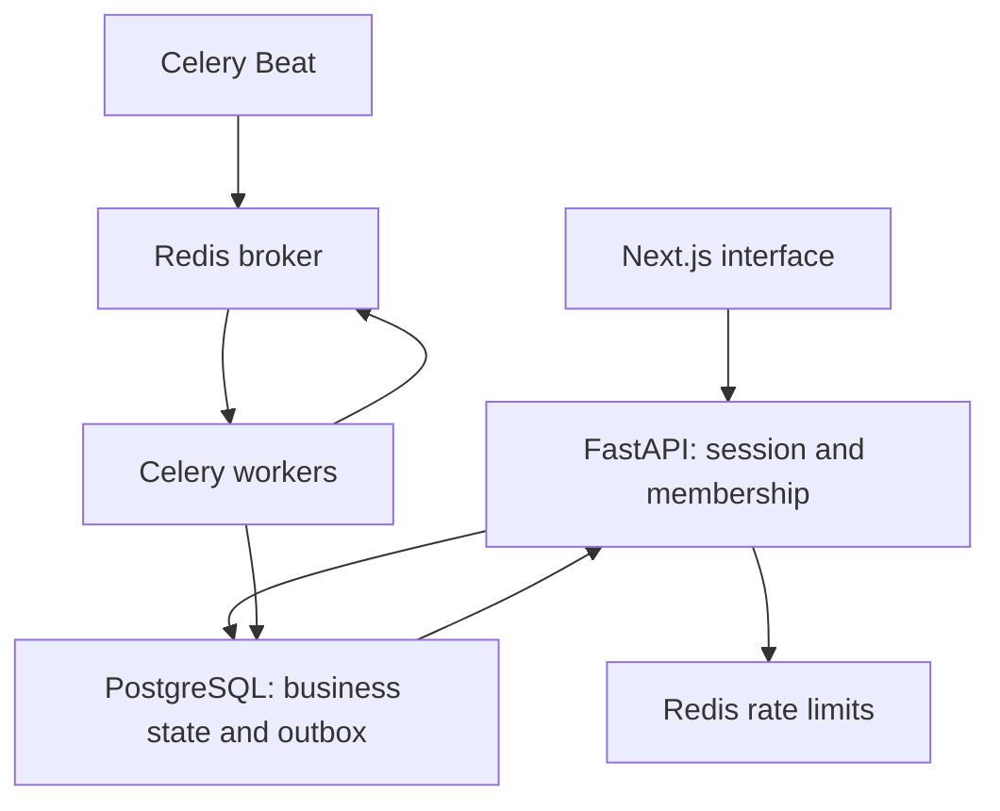

# Architecture

FlowOps AI is a modular FastAPI application, Next.js frontend and Celery worker pool. Next.js forwards same-origin `/api` requests to FastAPI. FastAPI Users provides expiring, revocable database sessions through an HttpOnly cookie. API dependencies enforce organization membership independently of frontend controls.

Lead changes and audit events commit together. Published graphs are immutable database snapshots. Run requests pin a published version and save execution state plus an outbox entry in one transaction. An organization-scoped idempotency key replays the same request; reusing it with another input returns 409. A request without an explicit version retains its original result even if a later version is published.

Beat dispatches a maintenance task every three seconds. A worker locks unpublished due outbox rows and publishes UUID-only execution messages. Publication failure retains the intent; overdue queued runs and expired leases are reconciled from PostgreSQL. Publication and acknowledgement can be duplicated. Execution row locks, leases and transactional step transitions prevent concurrent internal changes. Redis is not the source of business results.

A worker processes one node per task and commits the next dispatch with its result. Intent is persisted before any external call. Internal database effects, context, completed step and next dispatch commit together. A previous external intent without a recorded outcome fails as uncertain, blocks retries and requires reconciliation. This design does not promise exactly-once external delivery.

Nodes run from an explicit trusted registry; no user code or LLM output is executed. Conditions choose a single outgoing branch in an acyclic tree without joins. Delays persist a due time rather than sleeping. Generic approvals and email approvals are distinct: a generic checkpoint cannot authorize email. Approval decisions bind a payload hash and revision, lock execution before approval, and dispatch resumption transactionally. Expiry cancels the waiting run.

Lead creation queues matching active published workflows in the lead transaction. Scheduled workflows store their next due time in PostgreSQL. The scheduler locks due workflows and coalesces missed intervals into one run after downtime. Pausing stops new automatic runs; existing executions retain their pinned version. Workers recheck the publisher's or requester's current membership and active account before every node.

Each Celery task uses an async SQLAlchemy engine with NullPool because event loops are created per task. API sessions use a normal pool outside tests. Provider and scoring actions currently return an explicit unconfigured failure; AI, email adapters, CSV processing and webhooks belong to subsequent milestones.
