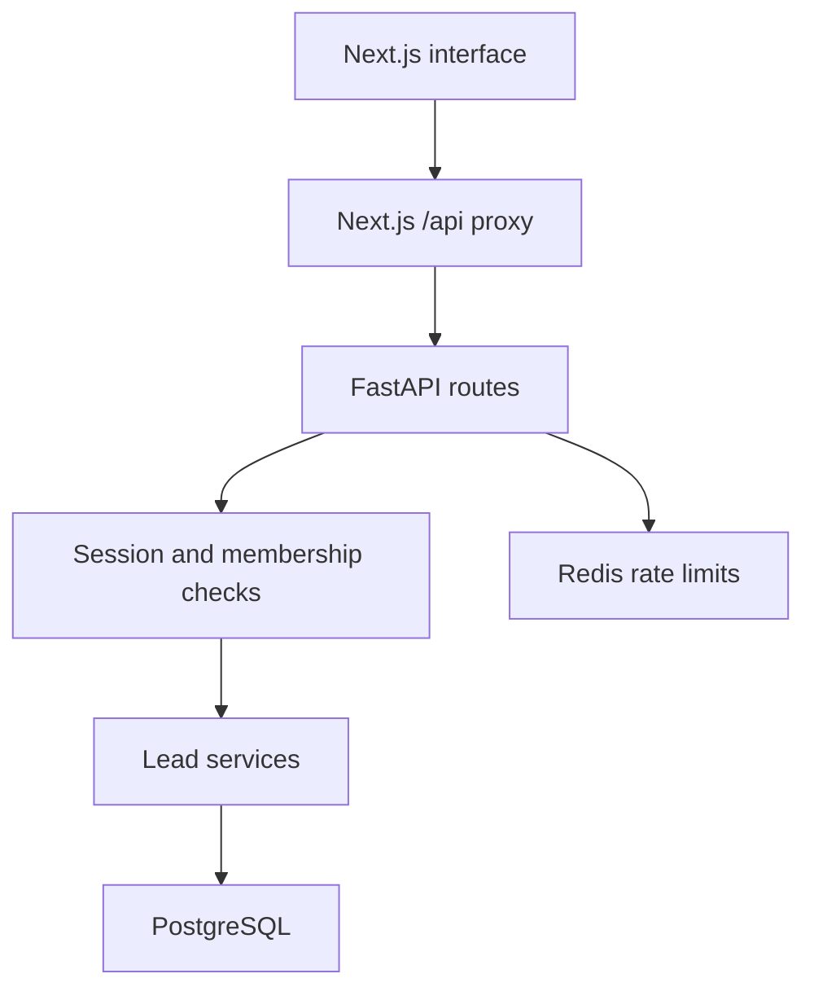

# Architecture

The foundation is a modular FastAPI application plus a Next.js frontend. Next.js forwards same-origin `/api` requests to FastAPI. FastAPI Users handles password hashing and expiring, revocable database sessions through an HttpOnly cookie. Backend dependencies authorize organization membership independently of frontend controls.

SQLAlchemy sessions isolate request transactions. Lead writes and audit events commit together. A unique PostgreSQL constraint prevents duplicate normalized email addresses inside a workspace. Route handlers call lead services; schemas validate input and allowlist response fields. Alembic applies a frozen initial schema through a dedicated migration service.

Redis currently supports shared rate limiting. Celery workers, workflow definitions, execution state, AI adapters and external integrations have not been implemented. They will extend this structure in subsequent milestones, following CHATGPT.md.
