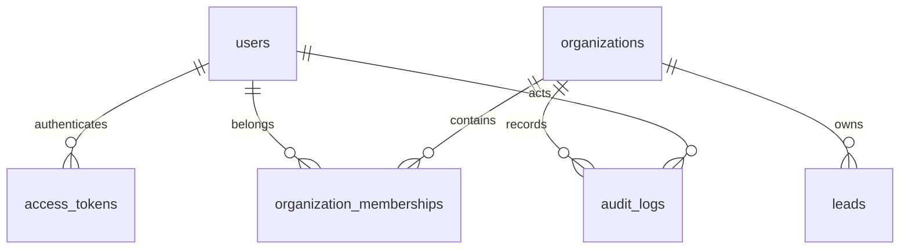

# Database

PostgreSQL is required. UUID primary keys and timezone-aware timestamps are used throughout.

| Table | Purpose | Important constraint |
|---|---|---|
| users | FastAPI Users accounts | Unique normalized email |
| access_tokens | Expiring database sessions | Unique token; user foreign key |
| organizations | Workspace identity | Unique slug |
| organization_memberships | User access and role | Unique organization/user pair; checked role |
| leads | Workspace-owned lead records | Unique organization/email; score between 0 and 100 |
| audit_logs | Workspace mutation history | Organization and actor foreign keys |

`alembic_version` tracks schema revisions. The first migration, `0001_foundation`, supports upgrade and downgrade. CI checks schema/model consistency with `alembic check` and applies upgrade, downgrade, and upgrade again against PostgreSQL 16.

Lead archive preserves data and normalized email uniqueness. Restoring changes status. Audit records contain action/resource/request identifiers, not message bodies or credentials. The `0002_workflows` migration adds `workflows` (mutable draft, revision, current version and state) and `workflow_versions` (immutable graph snapshots with a unique workflow/version number). A PostgreSQL trigger rejects updates/deletes to published versions. Publication and draft saving lock the workflow row and check the expected revision. Migration `0003_execution` adds workflow executions, execution steps, approval requests, durable outbox entries, worker heartbeat and internal notifications. Migration `0004_schedules` adds an indexed next-due timestamp to workflows. Migration `0005_scoring` adds immutable scoring profiles and profile/timestamp metadata on leads. Migration `0006_imports` adds import jobs/row reports and extends outbox entries to exactly one execution or import target. Migration `0007_outreach` adds structured email drafts and approval-linked delivery receipts, unique per execution/node. Migration `0008_integrations` adds non-secret integration settings, inbound event IDs/body hashes, outgoing delivery envelopes/leases/idempotency and bounded attempt history.

Execution idempotency is unique per organization/key. Step attempts are unique per execution/node/attempt. Outbox dispatch keys are unique, and approvals are unique per execution/node. Execution state pins the version and snapshots its display name/number. All decisions and business effects use timezone-aware timestamps.

Webhook events are unique per integration/external ID; outgoing deliveries are unique per integration/idempotency key, and attempts per delivery/number. Analytics use organization predicates and grouped SQL, with bounded history retrieval. See RETENTION.md for raw-upload/session cleanup and retained history.
